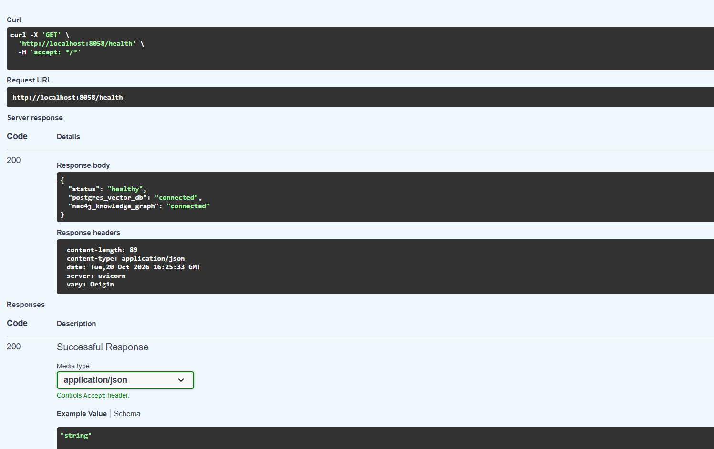
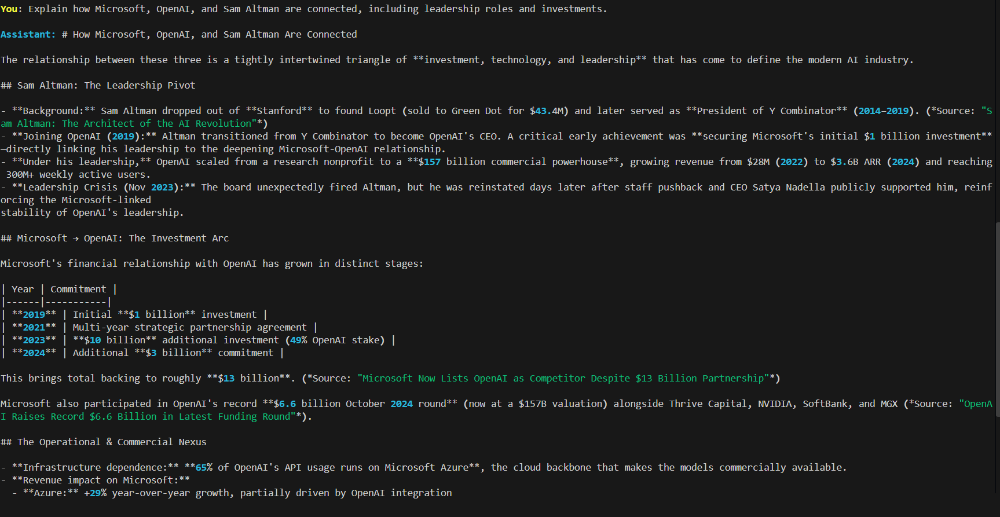
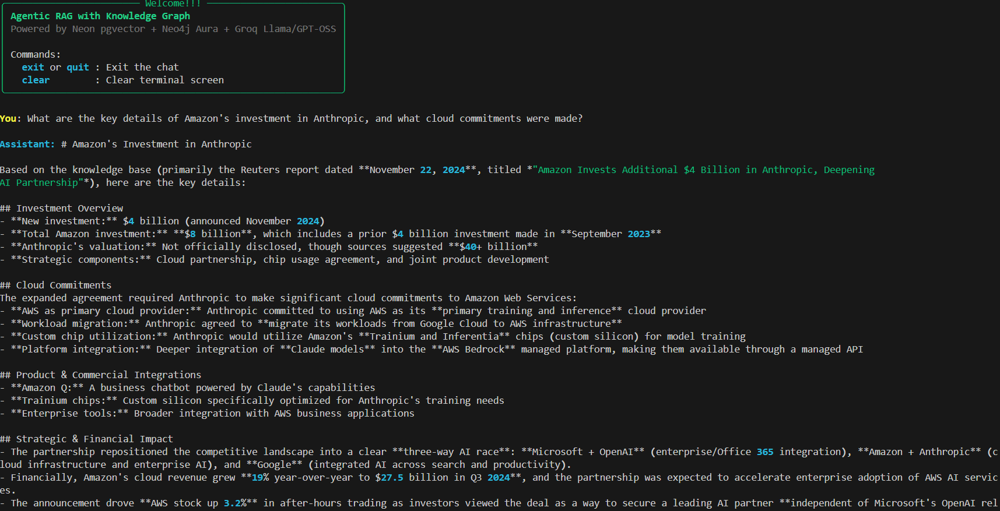

# Agentic RAG with Knowledge Graph

An enterprise-grade, dual-layer Agentic Retrieval-Augmented Generation (RAG) system combining PostgreSQL (pgvector) semantic search with a Neo4j Knowledge Graph orchestrated by Pydantic AI.

---

## Visual Demonstrations

### 1. Dual Database Health Verification (Swagger API)
FastAPI automated documentation interface confirming operational connectivity to both the Neon PostgreSQL vector database and the Neo4j Aura knowledge graph.

---

### 2. Multi-Hop Knowledge Graph Traversal (CLI)
Query demonstrating autonomous relationship extraction and multi-entity mapping across Microsoft, OpenAI, and leadership governance.

---

### 3. High-Fidelity Document Retrieval & Synthesis (CLI)
Query demonstrating semantic vector retrieval from PostgreSQL, extracting corporate investments, cloud agreements, and silicon hardware commitments with citations.

---

## Architecture Overview

Traditional RAG systems rely solely on vector search, which retrieves document passages based on semantic similarity but struggles with complex, multi-hop entity relationships.

This project integrates two complementary retrieval engines into an autonomous agent loop:

`
                            +------------------------+
                            |      User Request      |
                            +-----------+------------+
                                        |
                                        v
                            +------------------------+
                            |   Pydantic AI Agent    |
                            | (Groq Llama 3.3 / GPT) |
                            +-----------+------------+
                                        |
             +--------------------------+--------------------------+
             v                          v                          v
   +-------------------+      +-------------------+      +-------------------+
   |   vector_search   |      |   graph_search    |      |   hybrid_search   |
   +-------------------+      +-------------------+      +-------------------+
   | PostgreSQL + HNSW |      | Neo4j + Graphiti  |      | Vector + Keyword  |
   | Technical docs,   |      | Entities, nodes,  |      | Exact model codes |
   | narrative context |      | multi-hop links   |      | & product names   |
   +-------------------+      +-------------------+      +-------------------+
`

---

## Core Capabilities

- **Dual-Layer Retrieval**:
  - **Vector Database (Neon PostgreSQL)**: Stores chunked passages and dense vector embeddings with an HNSW cosine distance index.
  - **Knowledge Graph (Neo4j Aura)**: Stores entities and relations with temporal memory via Graphiti.
- **Autonomous Tool Selection**: The Pydantic AI agent dynamically chooses between ector_search, graph_search, or hybrid_search based on the user's intent.
- **Semantic Text Chunking**: Intelligent recursive chunker splitting on paragraph and sentence boundaries with configurable context overlap.
- **Real-Time Streaming API**: Built on FastAPI with Server-Sent Events (SSE) for token streaming.
- **Interactive Terminal Interface**: Terminal interface with formatting, real-time typing, and tool execution status.

---

## Repository Structure

`
├── agent/
│   ├── config.py         # Type-safe settings via pydantic-settings
│   ├── db.py             # Async connection pool (asyncpg) to PostgreSQL
│   ├── graph_utils.py    # Neo4j Aura & Graphiti integration
│   ├── tools.py          # vector_search, graph_search, hybrid_search
│   ├── prompts.py        # System prompt with decision rules
│   ├── agent.py          # Pydantic AI agent definition
│   └── api.py            # FastAPI REST and SSE streaming server
├── ingestion/
│   ├── chunker.py        # Semantic chunking with overlap
│   ├── embedder.py       # Batch vector embedding generator
│   └── ingest.py         # Full document ingestion pipeline
├── sql/
│   └── schema.sql        # pgvector extension, HNSW indexes & stored functions
├── big_tech_docs/        # Sample markdown documents for ingestion
├── cli.py                # Interactive streaming terminal client
├── .env.example          # Environment variable template
├── requirements.txt      # Python dependencies
└── README.md             # Project documentation
`

---

## Quickstart Guide

### 1. Prerequisites
- Python 3.10+
- Neon.tech PostgreSQL instance (with pgvector)
- Neo4j Aura instance
- Groq API key (or OpenAI API key)
- Ollama (optional, for local embeddings)

### 2. Installation
Clone the repository and set up a virtual environment:

`ash
git clone https://github.com/your-username/agentic-rag-knowledge-graph.git
cd agentic-rag-knowledge-graph

# Create virtual environment
python -m venv venv

# Activate virtual environment
# Windows (PowerShell):
.\venv\Scripts\Activate.ps1
# Linux / macOS:
source venv/bin/activate

# Install dependencies
pip install -r requirements.txt
`

### 3. Environment Configuration
Copy .env.example to .env and fill in your credentials:

`ash
cp .env.example .env
`

### 4. Initialize Database Schema
Run the database initializer to create the pgvector tables and HNSW index:

`ash
python -c import asyncio; from agent.db import init_db; asyncio.run(init_db())
`

### 5. Ingest Documents
Process the markdown files into vector embeddings and knowledge graph entities:

`ash
python -m ingestion.ingest -d big_tech_docs --fast --verbose
`

---

## Running the Application

### Step 1: Start the API Server
In Terminal 1, start the FastAPI streaming server:

`ash
python -m agent.api
`
The server will start on http://localhost:8058. You can view the interactive Swagger API documentation at http://localhost:8058/docs.

### Step 2: Launch the Interactive CLI
In Terminal 2, launch the streaming terminal interface:

`ash
python cli.py
`

---

## Query Examples

- **Relationship Query**:
  > *Explain how Microsoft, OpenAI, and Sam Altman are connected, including leadership roles and investments.*  
  > Tool Used: graph_search (traverses partnerships, investments, and Azure cloud exclusivity in Neo4j).
- **Technical Narrative Query**:
  > *What are the key details of Amazon's investment in Anthropic, and what cloud commitments were made?*  
  > Tool Used: ector_search (retrieves technical descriptions from PostgreSQL).

---

## License
This project is licensed under the MIT License.
