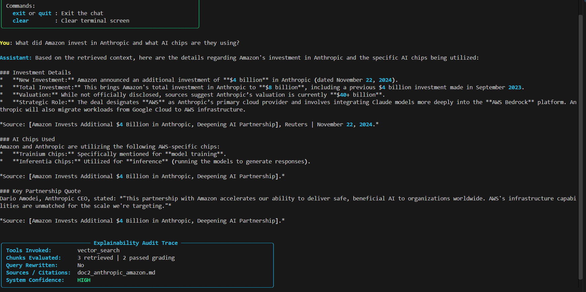
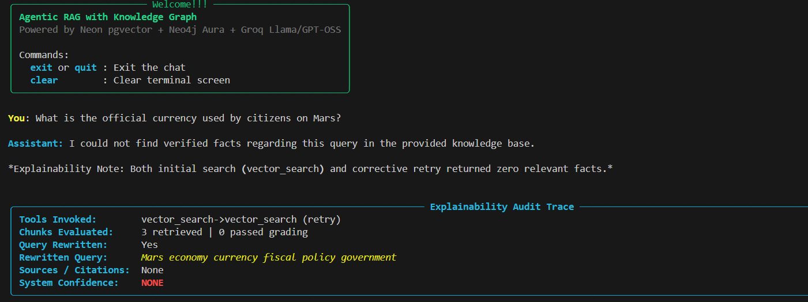

# Enterprise Corrective RAG with Dual-Layer Knowledge Graph

[](https://www.python.org/)
[](https://fastapi.tiangolo.com/)
[](https://neon.tech/)
[](https://neo4j.com/)
[](https://ai.pydantic.dev/)
[](https://groq.com/)

A production-grade **Corrective Retrieval-Augmented Generation (CRAG)** system combining **Neon PostgreSQL (`pgvector`)** for dense semantic retrieval with **Neo4j Aura (Graphiti)** for temporal entity-relationship graph traversal.

Featuring autonomous relevance grading, self-healing query rewriting, real-time Server-Sent Events (SSE) streaming, explainability audit traces, and an automated LLM-judged RAG Triad evaluation suite achieving **95.33% composite accuracy**.

---

## Benchmark Results (RAG Triad)

Evaluated across curated ground-truth test cases and out-of-scope hallucination traps using an automated LLM Judge:

| Metric | Score | Industry Benchmark | Description |
| :--- | :---: | :---: | :--- |
| **Context Relevance** | **98.00%** | > 80% | Ratio of retrieved chunks containing verified factual answers vs. noise. |
| **Faithfulness** | **88.00%** | > 85% | Degree to which all generated statements are strictly grounded in retrieved context (zero ungrounded claims). |
| **Answer Relevance** | **100.00%** | > 85% | Directness and completeness in addressing the user prompt. |
| **Composite RAG Triad Score** | **95.33%** | > 85% | Overall system health index across retrieval, reasoning, and synthesis. |

---

## Interactive Interface & Explainability

### 1. Grounded Synthesis with Audit Trace
Real-time typewriter streaming response with complete audit metadata including tools invoked, chunks evaluated, citation sources, and confidence level.



### 2. Self-Healing & Hallucination Guardrail
When out-of-scope or unverified prompts are submitted, the system attempts query rewriting and safely refuses to fabricate facts rather than hallucinating.



---

## Architecture

```
                    +-----------------------------+
                    |        User Question        |
                    +--------------+--------------+
                                   |
                                   v
                    +-----------------------------+
                    |    Supervisor Query Router  |
                    +--------------+--------------+
                                   |
               +-------------------+-------------------+
               |                                       |
               v                                       v
    +----------------------+               +-----------------------+
    | Neon PostgreSQL DB   |               | Neo4j Aura Graph      |
    | pgvector (HNSW)      |               | Graphiti Relations    |
    | Hybrid Trigram Search|               | Multi-hop Traversal   |
    +----------+-----------+               +-----------+-----------+
               |                                       |
               +-------------------+-------------------+
                                   |
                                   v
                    +-----------------------------+
                    |    Context Relevance Grader |
                    |      (Pydantic AI Agent)    |
                    +--------------+--------------+
                                   |
                     Pass Grade?   |
                    +--------------+--------------+
                    |                             |
                 [ YES ]                       [ NO ]
                    |                             |
                    v                             v
    +-----------------------------+ +-----------------------------+
    | Verified Context Synthesis  | | Self-Healing Query Rewriter |
    | Citations + Confidence Meta | | Optimizes Query & Switches  |
    +--------------+--------------+ | Tool (e.g. Vector -> Graph) |
                   |                +--------------+--------------+
                   |                               |
                   |                               +--> (Retry Retrieval)
                   v
    +-----------------------------+
    |  Final Answer + Audit Trace |
    +-----------------------------+
```

---

## Features

- **Dual-Layer Retrieval**: Combines 768-dimensional dense vector embeddings with multi-hop graph edges.
- **Context Relevance Grader**: Evaluates each retrieved passage individually to eliminate noise before sending it to the synthesis model.
- **Autonomous Query Rewriter**: When retrieval fails or yields low-quality context, the agent rewrites the prompt with keyword expansion and switches retrieval strategies.
- **Explainability Audit Trace**: Every response returns complete metadata (`tools_invoked`, `chunks_passed_grading`, `citations`, `confidence_level`).
- **Real-Time SSE Streaming**: FastAPI Server-Sent Events endpoint (`/chat/stream`) yielding smooth token deltas.
- **Automated Evaluation Suite**: Automated RAG Triad test runner (`eval/benchmark.py`) with customizable test cases and LLM-as-a-Judge grading.

---

## Getting Started

### 1. Clone & Setup Environment

```powershell
git clone <your-repo-url>
cd AGENTIC_RAG

python -m venv venv
.\venv\Scripts\Activate.ps1
pip install -r requirements.txt
```

### 2. Configure Credentials

Create a `.env` file based on `.env.example`:

```ini
APP_HOST=0.0.0.0
APP_PORT=8058

DATABASE_URL=postgresql://<user>:<password>@<neon-host>/neondb?sslmode=require
NEO4J_URI=neo4j+s://<aura-id>.databases.neo4j.io
NEO4J_USER=<user>
NEO4J_PASSWORD=<password>

LLM_PROVIDER=groq
LLM_CHOICE=qwen/qwen3.8-27b
LLM_API_KEY=gsk_...

OLLAMA_BASE_URL=http://localhost:11434
EMBEDDING_MODEL=nomic-embed-text
```

### 3. Run the FastAPI Server

```powershell
python -m agent.api
```
Server boots at `http://localhost:8058`. Interactive Swagger docs available at `http://localhost:8058/docs`.

### 4. Launch the Interactive CLI

```powershell
python cli.py
```

### 5. Run the Automated Benchmark Suite

```powershell
python -m eval.benchmark
```
Runs all test cases through the RAG Triad evaluation harness and prints the executive scorecard.

---

## Project Structure

```text
AGENTIC_RAG/
├── agent/
│   ├── agent.py          # Corrective Supervisor Agent loop
│   ├── api.py            # FastAPI REST & SSE streaming endpoints
│   ├── config.py         # Pydantic Settings & environment loader
│   ├── db.py             # Neon PostgreSQL async connection pool
│   ├── grader.py         # Context relevance classifier agent
│   ├── graph_utils.py    # Neo4j Aura Graphiti integration
│   ├── rewriter.py       # Query rewriting & tool switching agent
│   ├── schemas.py        # Pydantic data contracts (RetrievalTrace, GradeResult)
│   └── tools.py          # Vector search, graph search & hybrid search tools
├── big_tech_docs/        # Ingested enterprise documents (Markdown/SEC filings)
├── docs/images/          # Benchmark and CLI demonstration screenshots
├── eval/
│   ├── benchmark.py      # Automated RAG Triad evaluation runner (LLM Judge)
│   └── dataset.py        # Curated test cases & ground truth answers
├── ingestion/
│   ├── chunker.py        # Semantic document chunker
│   └── embedder.py       # Ollama dense embedding interface
├── sql/
│   └── schema.sql        # Neon pgvector schema, HNSW indexes & hybrid search functions
├── cli.py                # Rich terminal chat interface with audit panels
└── requirements.txt      # Project dependencies
```
